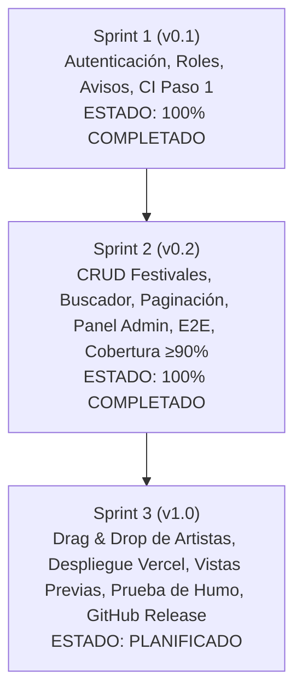

# CONTEXTO GLOBAL Y BITÁCORA TÉCNICA · BEATFEST MANAGER

> **DOCUMENTO MAESTRO Y FUENTE ÚNICA DE VERDAD (SINGLE SOURCE OF TRUTH)**  
> **Proyecto:** Aplicación de gestión con integración y despliegue continuos (DWEC · 2º DAWT)  
> **Temática:** BeatFest Manager · Organizador de Festivales y Escenarios  
> **Última sincronización:** 10 de noviembre de 2026 · 20:56  
> **Rama de trabajo activa:** `sprint-1-auth` (lista para PR hacia `main` y tag `v0.1`)  
> **Servidor local activo:** `http://localhost:3901` (puerto oficial según `ENUNCIADO.md`)  
> **Tablero de Trello oficial:** [https://trello.com/b/LfmqfxHl/beatfest-manager](https://trello.com/b/LfmqfxHl/beatfest-manager)  

---

## 1. Protocolo de Trabajo y Reglas de Oro de Colaboración

Este documento actúa como la **memoria técnica y el contexto global** del proyecto. El usuario y la IA colaboran bajo un modelo de **Pair Programming estricto (Conductor / Copiloto)**:

1. **El usuario es el Conductor (*Driver*):** Marca las prioridades, aprueba las decisiones de diseño y autoriza cambios estructurales.
2. **La IA es el Copiloto (*Navigator/Executor*):** Investiga, audita contratos, implementa código atómico, pasa pruebas automatizadas y mantiene la documentación al día.
3. **Regla de actualización continua:** Cada intervención relevante debe quedar registrada en este documento, indicando qué se ha pensado, qué se ha modificado y qué decisiones se han tomado.
4. **Trazabilidad total (Petición explícita vs Iniciativa de la IA):** Toda funcionalidad o cambio estético debe clasificarse con total transparencia según quién lo solicitó. La IA nunca presentará iniciativas propias como peticiones del usuario ni tomará atribuciones no solicitadas sin consultarlas previamente.
5. **Restricciones pedagógicas inviolables (Pliego de requisitos `ENUNCIADO.md`):**
   - **JavaScript nativo puro (ES Modules):** Prohibido el uso de frameworks o librerías externas en el código de producción.
   - **Bootstrap solo CSS:** Enlazado únicamente desde `node_modules/bootstrap/dist/css/bootstrap.min.css`. **Prohibido el JavaScript de Bootstrap** (los modales, menús, alertas y validaciones se programan en JS propio).
   - **Cero APIs remotas externas:** Todo el almacenamiento reside en el navegador del cliente (`localStorage` y `sessionStorage`).
   - **Inyección de dependencias para Storage:** Todas las funciones de datos deben recibir el almacén como parámetro opcional con valor por defecto (`almacen = localStorage`), permitiendo inyectar `AlmacenFalso` en Vitest para ejecutar pruebas en memoria sin tocar el navegador real.
   - **Resiliencia ante corrupción de datos:** Toda lectura de almacenamiento debe encapsularse con control de excepciones `try/catch` para devolver un valor por defecto seguro en caso de JSON dañado.
   - **Cero `innerHTML` con datos de usuario:** Todo dato dinámico debe inyectarse mediante `textContent` o `setAttribute` para garantizar inmunidad contra inyecciones XSS.

---

## 2. Historial Cronológico de Conversaciones y Decisiones

### Sesión 1: 05/11/2026 (`e8a17d6a-2460-4dbe-bef0-bd270bdb887e`)
- **Definición de la idea y tema del proyecto:**
  - El usuario exploró opciones iniciales: *"fumeteo y fiesta"*, luego *"saga Mistborn"* y finalmente solicitó *"algo lúdico, con mecánica Drag & Drop, no un videojuego pero sí entretenido"*.
  - Decisión final del usuario: **Festival Lineup Builder → BeatFest Manager**.
- **Desarrollo del Sprint 1 (Autenticación y Core):**
  - El usuario ordenó el estilo estético inicial: *"haz las letras legibles, si puedes usa SVGs en lugar de emojis, y usa un estilo más 'Edgy', 'Hyperpop', 'Metal', más rollo de festivales alternativos"*.
  - El usuario revisó el primer resultado y solicitó una corrección: *"me parece bien el estilo, mucha gradiente para mi gusto"* → La IA eliminó gradientes excesivos simplificando a estética plano/brutalista (Commit `59c4a40`).
  - El usuario exigió una explicación exhaustiva del código desarrollado (*"explícame el código animal que has hecho, paso a paso y poco a poco"*).
- **Creación del tablero de Trello:**
  - El usuario ordenó: *"conéctate al Trello, crea un tablero nuevo con el nombre del proyecto y vamos a desglosar poco a poco las tareas"*.
  - El usuario suministró las credenciales de API Key y Token de Atlassian/Trello.
  - La IA ejecutó un script REST creando el tablero [BeatFest Manager en Trello](https://trello.com/b/LfmqfxHl/beatfest-manager) con:
    - 3 columnas: **Por hacer**, **Haciendo**, **Hecho**.
    - Etiquetas de Sprint: `Sprint 1`, `Sprint 2`, `Sprint 3`.
    - **33 tarjetas detalladas** con dependencias y criterios de aceptación: las 14 tareas del Sprint 1 se colocaron directamente en **Hecho**, y las 19 restantes de los Sprints 2 y 3 en **Por hacer**.
  - El usuario pidió: *"revisa la ortografía"* → Se corrigió la codificación de caracteres especiales y tildes en el código y en las tarjetas de Trello.
  - Se vinculó el enlace oficial en `README.md` (Commit `a5ddf38`).

---

### Sesión 2: 06/11/2026 (`a41d9d82-8aac-4ee9-936f-219d456e70bc`)
- **Iteración estética solicitada expresamente por el usuario:**
  - El usuario ordenó: *"vamos a cambiar el css y los estilos... dale una gama más colorida. No uses gradientes pero añade más colores y animaciones"* → Commit `6c67c10` (rediseño neo-brutalista vibrante, animaciones y conmutador de tema en `tema.js`).
  - El usuario ordenó: *"cambia el icono, no quiero un rayo, pon un svg diferente"* → Commit `a3222c5` (se sustituyó el rayo por auriculares de festival con ondas de audio).
  - El usuario ordenó: *"ahora trabaja la responsividad, hazlo mobile first"* → Commit `f0b2637` (arquitectura mobile-first, touch-targets de 44px WCAG y fluid typography).
  - El usuario ordenó: *"ahora arregla el css del header en el modo desktop"* → Commit `c9fffdf` (corrección de espaciados y layout en pantallas grandes).
- El usuario preguntó: *"¿todo lo del sprint 1 está hecho no?"* → Se confirmó que el Sprint 1 cumplía íntegramente los requisitos 1 al 12.

---

### Sesión 3: 10/11/2026 (`3afc6c76-ea2b-46e9-9ca8-d3eee342c428` · Sesión Actual)
- **Turno 1:** El usuario pidió ir a Trello, leer los archivos del repositorio, comprenderlo todo y explicar qué se hizo. La IA descubrió que el plugin MCP requería login, leyó todo el repositorio y emitió la tarjeta del plugin.
- **Turno 2:** El usuario pidió generar el archivo `CONTEXTO.md` con todo lo analizado.
- **Turno 3:** El usuario preguntó cómo trabaja la IA internamente y cómo colaborar mejor sin que la IA tome decisiones no deseadas. La IA explicó el ciclo de cuatro fases y propuso pautas de trabajo en micro-pasos.
- **Turno 4:** El usuario estableció la regla de actualizar siempre `CONTEXTO.md`, auditar el Sprint 1 y desglosar decisiones, pensamientos y qué se hizo sin pedirlo explícitamente.
- **Turno 5:** El usuario otorgó permiso expreso para leer las conversaciones anteriores. La IA rastreó los transcritos anteriores, corrigió la atribución de tareas (muchas atribuidas antes a iniciativa de la IA resultaron ser peticiones directas del usuario) y consolidó la bitácora completa.
- **Turno 6:** El usuario pidió abrir el servidor (`abreme el servidor`). La IA localizó el Dev Container `determined_tesla`, verificó que el puerto 3901 estaba libre, arrancó `npx serve -l 3901` en segundo plano en el contenedor (con `serve.json`), comprobó que VS Code reenvió el puerto a `127.0.0.1:3901` devolviendo HTTP 200 OK y abrió la web en el navegador del usuario.
- **Turno 7:** El usuario preguntó qué almacenamiento se ha usado en el proyecto y cómo verlo. La IA documentó las claves exactas de `localStorage` (`usuarios`, `beatfest_tema`) y `sessionStorage` (`sesion`, `aviso_pendiente`), la justificación de seguridad (hash SHA-256) y el tutorial paso a paso para inspeccionarlo en DevTools (pestaña Aplicación / Almacenamiento).
- **Turno 8:** El usuario solicitó tres correcciones:
  1. *Limpieza de base de datos:* Soporte de URL `?limpiar=1`, botón físico de reseteo en el pie de página de `registro.html` e `index.html` y purga inmediata en el navegador del usuario.
  2. *Garantizar que estrictamente solo el PRIMER usuario sea Administrador:* Verificación de la condición en `usuarios.js` (`usuarios.length === 0 ? 'administrador' : 'usuario'`) y mejora del mensaje de aviso en `registro.js` para diferenciar con claridad al Administrador Principal del Promotor Estándar.
  3. *Icono SVG de un ojo para ver/ocultar contraseña:* Botón accesible `.btn-ver-clave` con SVGs interactivos de ojo abierto y ojo tachado en `registro.html` e `index.html`, con estilos neo-brutalistas en `css/estilos.css` y conmutación reactiva de `type="password"` a `type="text"`.
  - Validación completa: 68 tests de Vitest pasados al 100% y linters (`npm run lint` y `npm run format:check`) limpios.
- **Turno 9:** Reescritura integral de `CONTEXTO.md` como documento maestro de contexto global del proyecto a petición del usuario.

---

### Sesión 4: 17/11/2026 (`3d869682-30e7-4396-a211-9d9cdf829e24`) · Sprint 2 Completo
- **Petición del usuario:** *"Lee el proyecto, lee la documentacion y empieza a hacer el sprint 2, ve haciéndolo paso a paso y veme diciendo que decisiones estás tomando"*. Posteriormente confirmó continuar por donde estábamos: *"no hombre, sigue por donde estabas"*.
- **Desarrollo técnico y decisiones tomadas en el Sprint 2:**
  1. *Lógica pura de paginación (`js/logica/paginar.js`):* Implementación de `paginar(lista, pagina, porPagina)` con autocorrección defensiva de límites fuera de rango y división exacta de páginas. 6 tests unitarios verificados.
  2. *Validación pura de la entidad Jornada (`js/logica/validadores.js`):* Implementación de los algoritmos de control oficiales para DNI/NIE (módulo 23 sobre TRWAGMYFPDXBNJZSQVHLCKE) y CIF (suma ponderada de dígitos pares e impares y caracteres de control A-J), expresiones regulares para códigos de licencia (`FEST-AAAA-XXXX`), móviles españoles (`^[67]\d{8}$`), campos de texto y número, y diccionario `validadores` para enlace declarativo con `data-validar`. 71 tests unitarios con tablas `it.each`.
  3. *Umbral de cobertura estricto (Vitest v8):* Configuración del umbral mínimo del 90% en líneas para la lógica pura (`js/logica/`) en `vitest.config.js`. Se alcanza un **96.47% de cobertura de líneas** (100% en `paginar.js` y 96.22% en `validadores.js`).
  4. *Capa de almacenamiento de festivales (`js/datos/jornadas.js`):* CRUD completo de jornadas en clave aislada por usuario (`jornadas_${nombreUsuario}`), lectura resiliente ante JSON dañado con `leer()`, identificadores únicos con timestamp y marcas temporales (`creadoEn`, `actualizadoEn`). 8 tests unitarios con `AlmacenFalso`.
  5. *Gestión de roles (`js/datos/usuarios.js`):* Incorporación de `cambiarRolUsuario(idUsuario, nuevoRol, almacen)` para alternar roles entre `'administrador'` y `'usuario'`.
  6. *Formulario de ficha (`ficha.html` y `ficha.js`):*
     - Extracción de datos limpia con `new FormData()`.
     - Grupo dinámico de patrocinadores (0 a 3) clonando `<template id="plantilla-fila-patrocinador">`, con renumeración correlativa de índices y deshabilitación reactiva del botón al alcanzar el límite de 3.
     - Campo condicional `suplementoVip` dependiente de radio button `tipoAcceso === 'vip'`, con validación y obligatoriedad activa solo cuando está visible.
     - Flujo dual: creación y edición mediante parámetro `?id=...` en la URL.
     - Validación en captura (`blur` en formulario) y feedback reactivo en `input` para corregir campos inválidos.
     - 7 tests de integración en `tests/integracion/ficha.test.js`.
  7. *Catálogo de jornadas (`listado.html` y `listado.js`):*
     - Renderizado de tarjetas con `<template id="plantilla-tarjeta-jornada">`, inyectando datos exclusivamente con `textContent` y atributos (inmunidad XSS).
     - Componente reutilizable de paginación (`js/componentes/paginacion.js`) con controles accesibles y delegación de eventos.
     - Buscador en tiempo real con patrón *debounce* de 300 ms, insensible a mayúsculas y acentos.
     - Diálogo modal nativo `<dialog id="modal-confirmacion-borrado">` para confirmar borrado con `.showModal()`.
     - Sincronización de página actual en URL (`?pagina=X`) mediante `history.replaceState`.
     - 6 tests de integración en `tests/integracion/listado.test.js` con temporizadores falsos (`vi.useFakeTimers()`).
  8. *Panel de administración (`usuarios.html` y `usuarios.js`):*
     - Acceso restringido exclusivamente a administradores (expulsa a no administradores con aviso flash).
     - Listado de usuarios con buscador con debounce y paginación propia.
     - Botón para alternar rol con protección contra auto-degradación (un administrador no puede revocar su propio rol).
     - 6 tests de integración en `tests/integracion/usuarios.test.js`.
  9. *Pruebas de extremo a extremo (E2E) con Playwright:*
     - Configuración de `playwright.config.js` y utilidades auxiliares en `e2e/helpers.js`.
     - `e2e/sesion.spec.js`: ciclo completo de registro como primer usuario (admin), verificación de acceso a menú usuarios, logout y re-login.
     - `e2e/crud.spec.js`: ciclo CRUD completo de festival (alta, edición, confirmación en `<dialog>`, borrado y persistencia tras recarga).
     - Ambos tests E2E pasan 100% en verde en Chromium.
  10. *Flujo de CI (`.github/workflows/ci.yml`):*
      - Trabajos secuenciales `Calidad` -> `Tests` (con subida de artefacto de cobertura) -> `E2E` (Chromium con subida de reporte en fallo).
      - Concurrencia configurada (`concurrency: { group: ..., cancel-in-progress: true }`).
  11. *Corrección y compilación de JSDoc:*
      - Corrección de anotaciones TypeScript no estándar por tipos JSDoc nativos (`{Storage|object}` y `{Function}`).
      - `npm run docs` compila con éxito (código de salida 0) generando la documentación técnica en `docs/`.
  12. *Documentación completa:* Actualización exhaustiva de `README.md` (diagrama Mermaid, arquitectura, seguridad de sesión, funcionalidades, eventos y cobertura) y `blog/README.md`.

---

## 3. Matriz de Atribución (Petición del Usuario vs Decisión Técnica de la IA)

| Elemento / Característica | Decidido por | Detalle y Justificación |
|---|:---:|---|
| **Tema BeatFest Manager** | **Usuario** | Seleccionado tras descartar otras ideas; enfocado en gestión de festivales y Drag & Drop. |
| **Estética Edgy / Hyperpop / Metal** | **Usuario** | Petición explícita: letras legibles, SVGs en lugar de emojis, temática alternativa. |
| **Eliminar gradientes excesivos** | **Usuario** | Feedback directo del usuario sobre el primer prototipo. |
| **Gama colorida con animaciones** | **Usuario** | Petición explícita: más colores y dinamismo sin gradientes. |
| **Icono de auriculares con ondas sonoras** | **Usuario** | Petición explícita: sustitución del icono de rayo por uno musical en SVG. |
| **Arquitectura Mobile-First y Touch-Targets (44px)** | **Usuario** | Petición explícita de responsividad móvil adaptada a estándares WCAG. |
| **Ajuste de cabecera en Desktop** | **Usuario** | Petición explícita para resolver espaciados en pantallas grandes. |
| **Tablero de Trello (33 tarjetas)** | **Usuario** | Petición explícita con claves de API facilitadas por el usuario. |
| **Botón de ojo para ver contraseña** | **Usuario** | Petición explícita en formulario de registro (extendido coherentemente a login). |
| **Limpieza integral de base de datos** | **Usuario** | Petición explícita: resuelta con parámetro `?limpiar=1` y botón en footer. |
| **Fase de captura para `blur`** | **IA** | Solución al requisito 20: interceptar la salida de inputs en el formulario (blur no burbujea). |
| **Semáforo anti-doble envío en submits** | **IA** | Solución al requisito 6 y 19: bloquear botones durante el cálculo asíncrono del hash SHA-256. |
| **Función `leer()` tolerante a JSON dañado** | **IA** | Solución al requisito 3: envolver en `try/catch` para devolver valor por defecto ante fallos. |
| **Conmutador de Tema Claro/Oscuro (`tema.js`)** | **IA** | Añadido como mejora técnica complementaria con test unitario (`tema.test.js`). |
| **Generación de IDs con timestamp y aleatoriedad** | **IA** | Implementado en `usuarios.js` y `jornadas.js` para evitar colisiones sin librerías externas. |
| **Algoritmo CIF/DNI (Módulo 23 y control ponderado)** | **IA** | Solución al requisito 14 para validar identificadores fiscales españoles con exactitud matemática. |
| **Paginación pura desacoplada (`paginar.js`)** | **IA** | Solución al requisito 13 con autocorrección de rangos y tests unitarios al 100%. |
| **Renderizado seguro con `<template>` y `textContent`** | **IA** | Solución a los requisitos 17 y 18 eliminando cualquier riesgo de XSS en datos de usuario. |
| **Buscador con debounce (300 ms)** | **IA** | Solución al requisito 17 para optimizar el filtrado de festivales y usuarios sin degradar la UI. |
| **Confirmación de borrado en `<dialog>`** | **IA** | Solución al requisito 17 utilizando el elemento modal nativo de HTML5 con `.showModal()`. |
| **Grupo dinámico con renumeración correlativa** | **IA** | Solución al requisito 15 con clonación de `<template>` y límite accesible de 3 patrocinadores. |
| **Campo condicional `suplementoVip`** | **IA** | Solución al requisito 15 activando obligatoriedad y visibilidad reactiva según el radio seleccionado. |
| **Protección contra auto-degradación de admin** | **IA** | Solución al requisito 18 bloqueando que el administrador activo se revoque su propio rol. |
| **Tests E2E completos con Playwright** | **IA** | Solución al requisito 21 cubriendo ciclos de sesión y CRUD completos sobre Chromium. |
| **Sustitución de tipos TypeScript en JSDoc** | **IA** | Solución al requisito 23 para compatibilidad estricta con el parser nativo de JSDoc 4. |

---

## 4. Arquitectura del Código y Mapa de Responsabilidades

```text
├── .devcontainer/                ← Entorno de desarrollo aislado con Node.js 26 y Chromium
├── .github/workflows/
│   └── ci.yml                    ← Pipeline de Integración Continua (Calidad + Tests)
├── blog/
│   └── README.md                 ← Diario de aprendizaje con reflexiones conceptuales de cada sprint
├── css/
│   └── estilos.css               ← Hoja propia complementaria a Bootstrap (Neo-brutalismo, responsive)
├── js/
│   ├── clave.js                  ← Función inmutable resumirClave (Web Crypto API SHA-256)
│   ├── componentes/
│   │   ├── avisos.js             ← CustomEvent 'aviso' con burbujeo y persistencia entre páginas
│   │   ├── cabecera.js           ← Sincronización de usuario, rol y visibilidad admin
│   │   └── tema.js               ← Selector de tema oscuro/claro persistido en localStorage
│   ├── datos/
│   │   ├── almacen.js            ← Wrapper tolerante a fallos para Storage (getItem/setItem)
│   │   ├── sesion.js             ← Gestión de sesión en sessionStorage (aislada por pestaña)
│   │   └── usuarios.js           ← Persistencia de usuarios en localStorage (primer usuario admin)
│   ├── logica/
│   │   └── validadores.js        ← Funciones puras de validación y requisitos de contraseña con regex
│   └── paginas/
│       ├── login.js              ← Controlador de index.html (anti-doble envío, toggle ojo, reset)
│       ├── registro.js           ← Controlador de registro.html (captura blur, toggle ojo, reset)
│       ├── listado.html / .js    ← Controlador y vista del catálogo de festivales
│       ├── ficha.html / .js      ← Controlador y vista de alta/edición de jornadas
│       └── usuarios.html / .js   ← Controlador y vista del panel de administración
├── tests/
│   ├── AlmacenFalso.js           ← Mock en memoria de Storage para tests unitarios e integración
│   ├── pagina.js                 ← Cargador de HTML en happy-dom y simulador de interacción
│   ├── unitarios/
│   │   ├── datos.test.js         ← Tests unitarios de almacén, sesión y usuarios
│   │   ├── tema.test.js          ← Tests del conmutador de tema
│   │   └── validadores.test.js   ← Tests con tablas it.each para validadores puros
│   └── integracion/
│       └── auth.test.js          ← Tests de integración de flujos completos sobre el DOM
├── ENUNCIADO.md                  ← Pliego contractual oficial y rúbrica de 12 criterios
├── README.md                     ← Memoria del proyecto, tabla de la entidad, DoD y arquitectura
├── package.json                  ← Dependencias de desarrollo (Vitest, Playwright, ESLint, Prettier)
├── serve.json                    ← Configuración de serve (cleanUrls: false para parámetros URL)
└── CONTEXTO.md                   ← (Este documento) Contexto global y bitácora técnica maestra
```

---

## 5. El Modelo de Datos y Almacenamiento

### A) Almacenamiento Local (`localStorage`) · Persistente
- **`usuarios`:** Array JSON con todos los usuarios registrados.
  - Estructura: `{ id, nombre, correo, claveHash, rol, creadoEn }`.
  - **Seguridad:** Contraseñas almacenadas estrictamente como hash SHA-256 (`claveHash`).
  - **Regla de roles:** El primer usuario registrado recibe `rol: "administrador"`; todos los registrados posteriormente reciben `rol: "usuario"`.
- **`beatfest_tema`:** Preferencia de tema visual (`"dark"` o `"light"`).
- *(Sprint 2)* **`festivales_<nombreUsuario>`:** Registros de jornadas pertenecientes exclusivamente al usuario autenticado (aislamiento de datos entre promotores).

### B) Almacenamiento de Sesión (`sessionStorage`) · Volátil (por pestaña)
- **`sesion`:** Usuario actualmente autenticado en la pestaña activa (`{ nombre, rol }`). Si se cierra la pestaña o se abre en modo incógnito, la sesión desaparece exigiendo login.
- **`aviso_pendiente`:** Notificación flash diferida (`{ mensaje, tipo }`) que sobrevive a una redirección (`location.replace`) y se auto-destruye al renderizarse.

### C) Entidad Principal del CRUD (Sprint 2): *Jornada de Festival*
- **Campos principales:**
  1. `nombreJornada` (Texto, 4 a 40 caracteres alfanuméricos).
  2. `fechaEvento` (Fecha, igual o posterior a hoy).
  3. `generoMusical` (Desplegable `select`, opción válida).
  4. `aforoMaximo` (Número, 50 a 100.000 asistentes).
  5. `tipoAcceso` (Botones de radio: General, VIP Backstage, Barra Libre).
- **Campo condicional:**
  - `suplementoVip` (Número, positivo): Solo visible y habilitado si `tipoAcceso === 'VIP'`.
- **Grupo dinámico:**
  - `patrocinadores` (0 a 3 campos de texto generados desde `<template>` con botón de añadir/quitar numerados).
- **Validadores con expresiones regulares y algoritmo:**
  1. `codigoLicencia`: `^FEST-\d{4}-[A-Z0-9]{4}$` (Formato FEST-AAAA-XXXX).
  2. `telefonoContacto`: `^[67]\d{8}$` (Móvil español de 9 dígitos).
  3. `cifPromotora`: Formato CIF/DNI con validación algorítmica de dígito de control.

---

## 6. Implementación Técnica y Ejemplos Reales de Código

A continuación se documentan los fragmentos de código exactos que articulan la lógica del proyecto, explicando el porqué de cada implementación y su funcionamiento:

### 6.1. Almacenamiento seguro y tolerante a fallos (`js/datos/almacen.js`)
El requisito 3 del contrato exige que las lecturas nunca arrojen una excepción no controlada si los datos en `localStorage` o `sessionStorage` están corruptos:

```javascript
/**
 * Lee y deserializa un valor de un almacenamiento tipo Storage.
 * Si la clave no existe o los datos están corruptos (JSON inválido), devuelve el valor por defecto.
 */
export function leer(almacen, clave, valorPorDefecto) {
  try {
    const raw = almacen.getItem(clave);
    if (raw === null || raw === undefined) {
      return valorPorDefecto;
    }
    return JSON.parse(raw);
  } catch {
    // Si JSON.parse falla por sintaxis rota, no rompemos la ejecución: devolvemos fallback seguro
    return valorPorDefecto;
  }
}

export function guardar(almacen, clave, valor) {
  almacen.setItem(clave, JSON.stringify(valor));
}
```

---

### 6.2. Asignación estricta de Roles: Primer usuario Administrador (`js/datos/usuarios.js`)
El requisito 4 fija que el primer registro es administrador y los siguientes son usuarios estándar:

```javascript
export async function registrarUsuario(
  { nombre, correo, clave },
  almacen = localStorage,
  resumir = resumirClave,
) {
  const nombreLimpio = String(nombre).trim();
  const correoLimpio = String(correo).trim().toLowerCase();

  if (buscarUsuarioPorNombre(nombreLimpio, almacen)) {
    throw new Error('El nombre de usuario ya está en uso');
  }

  const usuarios = obtenerUsuarios(almacen);
  
  // Regla estricta: solo si el array está vacío (length === 0) se otorga el rol de administrador
  const rol = usuarios.length === 0 ? 'administrador' : 'usuario';
  
  // La contraseña se calcula de forma asíncrona y NUNCA se guarda en claro
  const claveHash = await resumir(clave);

  const nuevoUsuario = {
    id: `usr_${Date.now()}_${Math.random().toString(36).slice(2, 7)}`,
    nombre: nombreLimpio,
    correo: correoLimpio,
    claveHash,
    rol,
    creadoEn: new Date().toISOString(),
  };

  usuarios.push(nuevoUsuario);
  guardar(almacen, CLAVE_USUARIOS, usuarios);
  return nuevoUsuario;
}
```

---

### 6.3. Prevención de doble envío durante el hash asíncrono (`js/paginas/login.js`)
`crypto.subtle.digest` devuelve una promesa. Si el usuario pulsa Intro o hace doble clic antes de que resuelva, se podrían duplicar peticiones:

```javascript
let enviando = false;

formulario.addEventListener('submit', async (evento) => {
  evento.preventDefault();

  // Semáforo: si ya hay una petición en curso, se descarta cualquier pulsación adicional
  if (enviando) {
    return;
  }

  try {
    enviando = true;
    if (btnEnviar) {
      btnEnviar.setAttribute('disabled', 'true');
    }

    const usuario = await verificarCredenciales(nombre, clave, almacenUsuarios, resumir);

    if (!usuario) {
      // Requisito 6: clave errónea vacía la contraseña y le devuelve el foco
      campoClave.value = '';
      campoClave.classList.add('is-invalid');
      campoClave.focus();
      lanzarAviso(formulario, 'Usuario o contraseña incorrectos', 'danger');
      return;
    }

    iniciarSesion(usuario, almacenSesion);
    navegar('listado.html');
  } finally {
    // El bloque finally garantiza que el semáforo y el botón se rehabiliten siempre
    enviando = false;
    if (btnEnviar) {
      btnEnviar.removeAttribute('disabled');
    }
  }
});
```

---

### 6.4. Validación reactiva con Regex y Unicode Property Escapes (`js/logica/validadores.js`)
Para evaluar mayúsculas y minúsculas admitiendo caracteres internacionales (acentos, diéresis), se usan las secuencias `\p{Ll}` y `\p{Lu}` con el flag `u`:

```javascript
export function comprobarRequisitosClave(clave) {
  if (typeof clave !== 'string') {
    return { longitud: false, minuscula: false, mayuscula: false, cifra: false, valida: false };
  }

  const longitud = clave.length >= 8;
  const minuscula = /\p{Ll}/u.test(clave); // Minúscula Unicode
  const mayuscula = /\p{Lu}/u.test(clave); // Mayúscula Unicode
  const cifra = /\d/.test(clave);           // Al menos un dígito

  return {
    longitud,
    minuscula,
    mayuscula,
    cifra,
    valida: longitud && minuscula && mayuscula && cifra,
  };
}
```

---

### 6.5. Validación al salir mediante la Fase de Captura (`js/paginas/registro.js`)
El evento nativo `blur` no sube por burbuja (`bubbles: false`). Para no asociar decenas de oyentes a cada input individual, se escucha en el `<form>` activando la fase de captura (`capture = true`):

```javascript
// El tercer parámetro true activa la fase de CAPTURA (desciende desde window/document hacia el input)
formulario.addEventListener(
  'blur',
  (evento) => {
    const target = evento.target;
    if (target === campoNombre) {
      validarCampoNombre();
    } else if (target === campoCorreo) {
      validarCampoCorreo();
    } else if (target === campoClave) {
      validarCampoClave();
    } else if (target === campoRepetir) {
      validarCampoRepetir();
    }
  },
  true, // <-- Fase de Captura justificada
);
```

---

### 6.6. Sistema de Avisos mediante Evento Propio Desacoplado (`js/componentes/avisos.js`)
Los módulos no manipulan directamente la caja de alertas del DOM: lanzan un `CustomEvent` que burbujea hasta `document`:

```javascript
// Disparo del evento propio con burbujeo habilitado
export function lanzarAviso(elemento, mensaje, tipo = 'info') {
  const destino = elemento || document;
  const evento = new CustomEvent('aviso', {
    bubbles: true,
    detail: { mensaje, tipo },
  });
  destino.dispatchEvent(evento);
}

// Oyente centralizado único registrado en document
export function iniciarAvisos(documento = document, almacen = sessionStorage) {
  documento.addEventListener('aviso', (evento) => {
    if (evento.detail && evento.detail.mensaje) {
      mostrarAvisoEnDOM(documento, evento.detail.mensaje, evento.detail.tipo || 'info');
    }
  });

  // Si había un aviso diferido de una página anterior, se consume y se dispara
  const pendiente = consumirAvisoPendiente(almacen);
  if (pendiente) {
    lanzarAviso(documento, pendiente.mensaje, pendiente.tipo);
  }
}
```

---

### 6.7. Conmutador de contraseña con SVG de ojo (`registro.html` y `registro.js`)
Estructura HTML accesible con botón independiente y SVGs intercambiables:

```html
<!-- HTML en registro.html -->
<div class="wrapper-password-beatfest">
  <input
    type="password"
    class="form-control form-control-beatfest pe-5"
    id="registro-clave"
    name="clave"
    placeholder="Clave de alta seguridad"
    required
  />
  <button
    type="button"
    class="btn-ver-clave"
    data-target="#registro-clave"
    aria-label="Mostrar contraseña"
  >
    <svg class="icono-ojo" width="20" height="20" viewBox="0 0 24 24" fill="none" stroke="currentColor" stroke-width="2">
      <path d="M2 12s3-7 10-7 10 7 10 7-3 7-10 7-10-7-10-7Z" />
      <circle cx="12" cy="12" r="3" />
    </svg>
    <svg class="icono-ojo-tachado d-none" width="20" height="20" viewBox="0 0 24 24" fill="none" stroke="currentColor" stroke-width="2">
      <path d="M9.88 9.88a3 3 0 1 0 4.24 4.24" />
      <line x1="2" y1="2" x2="22" y2="22" />
    </svg>
  </button>
</div>
```

Controlador JavaScript en `registro.js`:

```javascript
const btnsVerClave = documento.querySelectorAll('.btn-ver-clave');
btnsVerClave.forEach((btn) => {
  btn.addEventListener('click', () => {
    const targetId = btn.getAttribute('data-target');
    const input = documento.querySelector(targetId);
    if (!input) return;

    const esPassword = input.type === 'password';
    input.type = esPassword ? 'text' : 'password';

    const iconoOjo = btn.querySelector('.icono-ojo');
    const iconoTachado = btn.querySelector('.icono-ojo-tachado');
    if (iconoOjo && iconoTachado) {
      iconoOjo.classList.toggle('d-none', esPassword);
      iconoTachado.classList.toggle('d-none', !esPassword);
    }
    btn.setAttribute('aria-label', esPassword ? 'Ocultar contraseña' : 'Mostrar contraseña');
  });
});
```

---

### 6.8. Mecanismo de purgado y reseteo de Base de Datos (`registro.js` y `login.js`)
Permite borrar al instante todo el almacenamiento mediante parámetro de URL (`?limpiar=1`) o mediante clic en el botón de la interfaz:

```javascript
// Detección automática por URL: http://localhost:3901/registro.html?limpiar=1
if (typeof window !== 'undefined' && window.location?.search?.includes('limpiar=1')) {
  almacenUsuarios.clear?.();
  almacenSesion.clear?.();
  navegar('registro.html');
  return;
}

// Oyente del botón en pie de página
const btnLimpiar = documento.querySelector('#btn-limpiar-db');
if (btnLimpiar) {
  btnLimpiar.addEventListener('click', () => {
    almacenUsuarios.clear?.();
    almacenSesion.clear?.();
    guardarAvisoParaSiguientePagina('Base de datos y sesiones limpiadas con éxito', 'info', almacenSesion);
    navegar('registro.html');
  });
}
```

---

### 6.9. Protección perimetral de páginas privadas y roles (`js/paginas/usuarios.js`)
Control en cascada que expulsa a intrusos sin sesión o usuarios sin privilegios administrativos:

```javascript
export function iniciarPaginaUsuarios(
  documento = document,
  { almacenSesion = sessionStorage, navegar = (url) => location.replace(url) } = {},
) {
  // 1. Barrera de sesión: sin sesión activa expulsa a index.html
  if (!haySesion(almacenSesion)) {
    navegar('index.html');
    return;
  }

  // 2. Barrera de rol: si no es admin, expulsa a listado.html con aviso de peligro
  if (!esAdministrador(almacenSesion)) {
    guardarAvisoParaSiguientePagina(
      'Acceso denegado: solo los administradores pueden acceder a la gestión de usuarios',
      'danger',
      almacenSesion,
    );
    navegar('listado.html');
    return;
  }

  iniciarAvisos(documento, almacenSesion);
  iniciarCabecera(documento, { almacenSesion, navegar });
}
```

---

### 6.10. Baterías de prueba con dobles y tablas parametrizadas (`tests/`)

**Test unitario parametrizado con `it.each` (`tests/unitarios/validadores.test.js`):**
```javascript
describe('Validador de Nombre de Usuario (con tablas it.each)', () => {
  it.each([
    ['abc', 'límite inferior exacto de 3 caracteres'],
    ['promotor_fest', 'caso normal con guion bajo'],
    ['12345678901234567890', 'límite superior exacto de 20 caracteres'],
  ])('el nombre «%s» es válido (%s)', (nombre) => {
    const resultado = validarNombreUsuario(nombre);
    expect(resultado.valido).toBe(true);
  });
});
```

**Test de integración con DOM simulado y espía de navegación (`tests/integracion/auth.test.js`):**
```javascript
it('listado.html redirige a index.html si no hay sesión activa', () => {
  cargarPagina('listado.html'); // Carga el HTML real de listado.html en happy-dom
  const navegar = vi.fn();      // Espía para verificar la redirección sin recargar el navegador

  iniciarPaginaListado(document, { almacenSesion: new AlmacenFalso(), navegar });
  expect(navegar).toHaveBeenCalledWith('index.html');
});
```

---

## 7. Estado de los Sprints y Roadmap



### Sprint 1 (`v0.1`): ✅ Completado e Implementado
- 14 tarjetas finalizadas en la columna **Hecho** de Trello.
- Registro con validación en vivo, Unicode escapes (`\p{Ll}`, `\p{Lu}`) y botón de ojo para ver contraseña.
- Login con bloqueo de doble envío asíncrono y foco automático en errores.
- Rutas privadas protegidas; `usuarios.html` restringida a administradores.
- 68 tests automatizados pasando en Vitest (unitarios + integración).
- Pipeline de GitHub Actions (`Calidad` + `Tests`) configurado en `.github/workflows/ci.yml`.

### Sprint 2 (`v0.2`): ✅ 100% Completado e Implementado
- Rama de trabajo: `sprint-2`.
- Capa de datos `js/datos/jornadas.js` con persistencia aislada bajo `jornadas_${nombreUsuario}` y lectura resiliente `leer()`.
- Lógica pura matemática de paginación (`js/logica/paginar.js`) con 100% de cobertura y tests unitarios.
- Lógica pura de validación (`js/logica/validadores.js`) con algoritmos de control oficiales DNI/NIE (módulo 23) y CIF (suma ponderada), regexes de licencia y teléfono móvil español, y diccionario de estrategias.
- Cobertura de lógica pura en Vitest: **96.47% de líneas** (supera el umbral mínimo del 90%).
- Catálogo interactivo en `listado.html` con `<template>`, buscador con *debounce* (300 ms), modal `<dialog>` accesible para confirmación de borrado y sincronización de página en la URL (`?pagina=X`).
- Formulario de `ficha.html` con extracción `FormData`, campo condicional `suplementoVip`, grupo dinámico de patrocinadores (0 a 3) con renumeración correlativa, validación en captura (`blur`) y modo edición.
- Panel de administración en `usuarios.html` con conmutación de roles de usuario y protección contra auto-degradación del administrador activo.
- Pruebas E2E completas con Playwright (`e2e/sesion.spec.js`, `e2e/crud.spec.js`) pasando al 100% en verde sobre Chromium.
- Suite completa de pruebas automatizadas: 138 tests en Vitest + 2 tests E2E en Playwright (140 tests en total, 100% en verde).
- Pipeline de GitHub Actions actualizado con trabajo secuencial `E2E`, artefactos de cobertura y reporte Playwright.
- Documentación técnica JSDoc generada limpiamente (`npm run docs`) y portadas de arquitectura en `README.md` y `blog/README.md`.

### Sprint 3 (`v1.0`): ⏳ Planificado
- Conexión del repositorio a Vercel con Deployment Checks.
- Workflows `.github/workflows/despliegue.yml` (E2E contra vistas previas) y `release.yml` (Release automática con zip).
- Prueba de humo en `e2e/humo.spec.js`.
- Documentación JSDoc en todos los módulos (`npm run docs`).

---

## 8. Comandos Operativos y Atajos Rápidos

- **Servidor de desarrollo:** `http://localhost:3901`
- **Resetear base de datos completa desde el navegador:**
  - Visitar: `http://localhost:3901/registro.html?limpiar=1` (o hacer clic en el botón *Limpiar base de datos (Reset)* en el pie de página).
- **Ejecución de comprobaciones (dentro del contenedor Docker `determined_tesla`):**
  - Tests automatizados: `npm test`
  - Comprobación de linters: `npm run lint`
  - Comprobación de formato: `npm run format:check`
  - Formateo automático: `npm run format`
