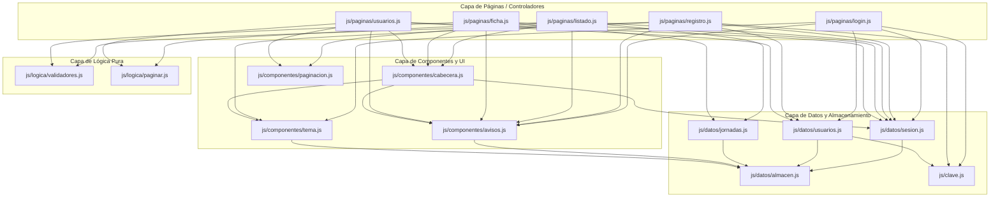

# BeatFest Manager · Organizador de Festivales y Escenarios

<!-- Sprint 2: la insignia de tu workflow, con tu organización y tu repositorio. -->


## Mi proyecto

**BeatFest Manager** es una aplicación web para directores artísticos, promotores y coordinadores de festivales musicales que permite diseñar, organizar y gestionar carteles de eventos (*lineups*), escenarios y jornadas de conciertos. Cuenta con una mecánica interactiva de **Drag & Drop** para asignar y reorganizar artistas entre escenarios y horarios, control de accesos VIP y patrocinadores.

**Web publicada:** <!-- https://<proyecto>.vercel.app -->

### La entidad: Jornada de Festival

| Campo | Control | Obligatorio | Regla de validación | Mensaje si no se cumple |
|-------|---------|:-----------:|---------------------|-------------------------|
| `nombreJornada` | Texto (`<input type="text">`) | Sí | Entre 4 y 40 caracteres alfanuméricos | El nombre debe tener entre 4 y 40 caracteres |
| `fechaEvento` | Fecha (`<input type="date">`) | Sí | Fecha igual o posterior a la actual | La fecha no puede ser anterior a hoy |
| `generoMusical` | Desplegable (`<select>`) | Sí | Debe seleccionar una opción válida | Selecciona un género musical principal |
| `aforoMaximo` | Número (`<input type="number">`) | Sí | Entre 50 y 100.000 asistentes | El aforo debe estar entre 50 y 100.000 personas |
| `tipoAcceso` | Botones de opción (`<input type="radio">`) | Sí | Selección obligatoria (General, VIP Backstage o Barra Libre) | Debes seleccionar un tipo de acceso |
| `suplementoVip` *(campo condicional)* | Número (`<input type="number">`) | Sí (si VIP) | Número positivo mayor o igual a 0 | El suplemento VIP debe ser un importe válido |
| `patrocinadores` *(grupo dinámico, mín 0, máx 3)* | Texto (`<input type="text">`) | No | Entre 2 y 30 caracteres por patrocinador | El nombre del patrocinador debe tener entre 2 y 30 caracteres |
| `codigoLicencia` | Texto (`<input type="text">`) | Sí | Expresión regular: `^FEST-\d{4}-[A-Z0-9]{4}$` | Formato requerido: FEST-AAAA-XXXX |
| `telefonoContacto` | Teléfono (`<input type="tel">`) | Sí | Expresión regular española: `^[67]\d{8}$` | Debe ser un teléfono móvil español válido (9 dígitos) |
| `cifPromotora` | Texto (`<input type="text">`) | Sí | Formato CIF/DNI y validación algorítmica de control | El identificador de la promotora no es válido |

### El registro de usuarios

| Campo | Control | Regla | Mensaje |
|-------|---------|-------|---------|
| `nombreUsuario` | Texto (`<input type="text">`) | Entre 3 y 20 caracteres alfanuméricos (`^[a-zA-Z0-9_-]{3,20}$`) y no ocupado | Debe tener entre 3 y 20 caracteres (solo letras, números y guiones) y estar libre |
| `correo` | Correo (`<input type="email">`) | Formato de correo electrónico estándar | Introduce un correo electrónico válido |
| `clave` | Contraseña (`<input type="password">`) | Mínimo 8 caracteres, al menos una mayúscula (`\p{Lu}`), una minúscula (`\p{Ll}`) y un número (`\d`) | La contraseña debe cumplir los requisitos de seguridad |
| `repetirClave` | Contraseña (`<input type="password">`) | Debe coincidir exactamente con `clave` | Las contraseñas no coinciden |
| `aceptarTerminos` | Casilla (`<input type="checkbox">`) | Casilla marcada obligatoriamente | Debes aceptar los términos y condiciones del festival |

### Páginas

| Página | Acceso | Qué hace |
|--------|--------|----------|
| `index.html` | Pública | Inicio de sesión con usuario y contraseña (redirige al listado si ya hay sesión activa). |
| `registro.html` | Pública | Registro de nuevos promotores/usuarios con validación en tiempo real y requisitos visuales. El primer usuario registrado es Administrador. |
| `listado.html` | Privada (Usuarios y Admins) | Catálogo de jornadas de festivales con buscador *debounce*, paginación, edición y borrado con confirmación en `<dialog>`. |
| `ficha.html` | Privada (Usuarios y Admins) | Alta y edición de jornadas con campo condicional, grupo dinámico de patrocinadores y tablero drag & drop. |
| `usuarios.html` | Privada (Solo Administradores) | Listado y gestión de usuarios registrados para asignar/revocar el rol de administrador, con protección contra auto-bloqueo. |

## Arquitectura y módulos

### Diagrama de dependencias entre módulos



### Catálogo de módulos

| Módulo | Responsabilidad principal | ¿Usa DOM? | Exportaciones principales |
|---|---|:---:|---|
| `js/datos/almacen.js` | Persistencia genérica y resiliente ante datos corruptos con `try/catch`. | No | `leer`, `guardar`, `eliminar` |
| `js/datos/sesion.js` | Ciclo de vida y consulta de la sesión activa en el navegador. | No | `obtenerSesion`, `iniciarSesion`, `cerrarSesion`, `haySesion`, `esAdministrador`, `obtenerUsuarioActual`, `CLAVE_SESION` |
| `js/datos/usuarios.js` | CRUD de usuarios, control de roles (primer usuario administrador) y verificación de contraseñas. | No | `obtenerUsuarios`, `buscarUsuarioPorNombre`, `buscarUsuarioPorCorreo`, `registrarUsuario`, `verificarCredenciales`, `cambiarRolUsuario`, `CLAVE_USUARIOS` |
| `js/datos/jornadas.js` | CRUD de jornadas de festivales en clave aislada por usuario (`jornadas_${usuario}`). | No | `obtenerClaveJornadas`, `obtenerJornadas`, `obtenerJornadaPorId`, `guardarJornada`, `eliminarJornada` |
| `js/clave.js` | Resumen criptográfico SHA-256 de contraseñas mediante Web Crypto API. | No | `resumirClave` |
| `js/logica/validadores.js` | Funciones puras de validación de campos (criterios, regexes, módulo 23 CIF/DNI). | No | `validarNombreJornada`, `validarFechaEvento`, `validarGeneroMusical`, `validarAforoMaximo`, `validarTipoAcceso`, `validarSuplementoVip`, `validarNombrePatrocinador`, `validarCodigoLicencia`, `validarTelefonoContacto`, `validarCifPromotora`, `validarNombreUsuario`, `validarCorreo`, `validarClave`, `validarRepetirClave`, `validarTerminos`, `validadores` |
| `js/logica/paginar.js` | Algoritmo puro de paginación con autocorrección de límites fuera de rango. | No | `paginar` |
| `js/componentes/avisos.js` | Notificaciones accesibles mediante `CustomEvent` y mensajes flash en sesión. | Sí | `lanzarAviso`, `guardarAvisoParaSiguientePagina`, `consumirAvisoPendiente`, `mostrarAvisoEnDOM`, `iniciarAvisos` |
| `js/componentes/cabecera.js` | Renderizado y sincronización de cabecera privada, visualización de rol y cierre de sesión. | Sí | `iniciarCabecera` |
| `js/componentes/tema.js` | Conmutador y sincronización del tema visual (oscuro/claro) en el atributo `data-bs-theme`. | Sí | `iniciarTema` |
| `js/componentes/paginacion.js` | Renderizado de controles de paginación accesibles y delegación de eventos. | Sí | `renderizarPaginacion` |
| `js/paginas/login.js` | Controlador de inicio de sesión (`index.html`), gestión de credenciales y redirección. | Sí | `iniciarPaginaLogin` |
| `js/paginas/registro.js` | Controlador del formulario de registro (`registro.html`) con comprobación en tiempo real. | Sí | `iniciarPaginaRegistro` |
| `js/paginas/listado.js` | Controlador del catálogo (`listado.html`), renderizado con `<template>`, búsqueda con debounce y modal `<dialog>`. | Sí | `iniciarPaginaListado` |
| `js/paginas/ficha.js` | Controlador de alta y edición de jornadas (`ficha.html`), campo condicional, grupo dinámico y validación en captura. | Sí | `iniciarPaginaFicha` |
| `js/paginas/usuarios.js` | Controlador de administración (`usuarios.html`), cambio de roles y protección de auto-bloqueo. | Sí | `iniciarPaginaUsuarios` |

### Estructura de objetos y patrones de diseño

En BeatFest Manager los datos se gestionan mediante **objetos literales planos** (*Plain Old JavaScript Objects*) y **funciones fábrica**, prescindiendo de jerarquías de clases para garantizar una serialización transparente a JSON y una arquitectura funcional y desacoplada. Se aplican los siguientes patrones de diseño:

1. **Inyección de Dependencias (Dependency Injection):**
   - *Dónde:* En los módulos de datos (`almacen = localStorage`), funciones criptográficas (`resumir = resumirClave`) y controladores de página (`almacenUsuarios`, `almacenSesion`, `navegar = (url) => location.assign(url)`).
   - *Por qué:* Permite desacoplar totalmente las funciones de los objetos globales del navegador (`window`, `localStorage`, `location`). En las pruebas automatizadas se inyectan dobles de prueba (`AlmacenFalso`) y espías de navegación (`vi.fn()`), aislando la ejecución de cada test sin efectos secundarios en el almacenamiento real.

2. **Observador desacoplado (Observer Pattern) mediante `CustomEvent`:**
   - *Dónde:* En `js/componentes/avisos.js` para emitir y escuchar el evento `'aviso'`.
   - *Por qué:* Permite que cualquier elemento de la interfaz o módulo lance notificaciones mediante `lanzarAviso(elemento, mensaje, tipo)` sin tener conocimiento de cómo ni dónde se dibujará la alerta en el DOM. Un único oyente registrado en `document` captura el evento en fase de burbuja y actualiza de manera centralizada la región viva accesible `#zona-avisos`.

3. **Diccionario de Estrategias (Strategy / Object Dictionary):**
   - *Dónde:* Diccionario `validadores` en `js/logica/validadores.js`.
   - *Por qué:* Mapea de forma declarativa cada atributo `data-validar` de los controles HTML con su función pura de validación (`validadores[campo.dataset.validar](campo.value)`). Esto sustituye complejas cadenas de `if/else` o `switch` por una tabla de búsqueda limpia, facilitando la adición de nuevas reglas de negocio sin modificar el controlador del formulario.

4. **Clausura de Debounce (Debounce Pattern):**
   - *Dónde:* En los buscadores en tiempo real de `js/paginas/listado.js` y `js/paginas/usuarios.js`.
   - *Por qué:* Mantiene en un cierre léxico el identificador de un temporizador (`setTimeout`), posponiendo el filtrado y re-renderizado 300 ms tras la última pulsación de tecla. Evita bloquear el hilo principal y realizar repintados innecesarios del DOM en cada pulsación.

### Testabilidad y recepción de dependencias

Cada controlador de página (`iniciarPagina*`) recibe el objeto `Document` y un objeto de opciones con sus dependencias configurables con valores por defecto del navegador:
```javascript
export function iniciarPaginaFicha(
  documento = document,
  {
    almacenSesion = sessionStorage,
    almacenJornadas = localStorage,
    navegar = (url) => location.assign(url),
    idJornada = null,
  } = {},
) { ... }
```
Gracias a este diseño:
- En producción, el módulo se ejecuta sin argumentos adicionales tomando el entorno real.
- En pruebas de integración (`happy-dom`), se carga el documento con `cargarPagina('ficha.html')` y se inyectan instancias limpias de `AlmacenFalso` y una función espía `navegar = vi.fn()`, permitiendo simular sesiones normales, sesiones de administrador o accesos no autorizados sin alterar el navegador ni generar recargas de página.

### Documentación técnica JSDoc

Todos los módulos, funciones, parámetros y retornos están tipados y documentados exhaustivamente según la especificación formal de JSDoc.
Para compilar y generar la documentación técnica en HTML:
```bash
npm run docs
```
El archivo de configuración `jsdoc.json` procesa recursivamente la carpeta `js/` utilizando `README.md` como portada de la documentación y genera el sitio estático resultante en el directorio `docs/`.

---

## Cómo ejecutarlo

### Requisitos previos
- Node.js 20 LTS o superior.
- Visual Studio Code con la extensión **Dev Containers** (opción recomendada para ejecutar el entorno estandarizado sin instalar dependencias en el sistema anfitrión).

### Puesta en marcha en Dev Container
1. Clonar el repositorio y abrir la carpeta en VS Code.
2. Pulsar `F1` y seleccionar **Dev Containers: Reopen in Container**.
3. El contenedor instalará automáticamente las dependencias del proyecto (`npm ci`) y configurará las extensiones de desarrollo.

### Scripts de desarrollo y calidad

| Comando | Acción |
|---|---|
| `npm run dev` | Inicia el servidor estático local para visualizar la aplicación web. |
| `npm test` | Ejecuta la suite de pruebas unitarias y de integración con Vitest. |
| `npm run coverage` | Ejecuta las pruebas y genera el informe de cobertura con umbral mínimo del 90% en lógica pura. |
| `npm run e2e` | Ejecuta las pruebas de extremo a extremo automatizadas con Playwright sobre Chromium. |
| `npm run lint` | Analiza el código con ESLint aplicando reglas estrictas de calidad y estilo. |
| `npm run format:check` | Comprueba si todos los archivos respetan el formato estricto de Prettier. |
| `npm run format` | Formatea automáticamente todos los archivos del proyecto con Prettier. |
| `npm run docs` | Genera la documentación técnica completa del proyecto con JSDoc en la carpeta `docs/`. |
| `npm run build` | Prepara la compilación estática lista para producción en el directorio `dist/`. |

---

## Almacenamiento y sesión

### Claves de almacenamiento

| Clave | Ubicación | Qué guarda | Ejemplo de contenido |
|---|---|---|---|
| `usuarios` | `localStorage` | Colección completa de usuarios registrados, roles y contraseñas hasheadas en SHA-256. | `[{"id":"usr_1731872400_abc12","nombre":"admin","correo":"admin@beatfest.es","claveHash":"8c6976e5b5410415bde908bd4dee15dfb167a9c873fc4bb8a81f6f2ab448a918","rol":"administrador","creadoEn":"2026-11-17T20:00:00.000Z"}]` |
| `jornadas_${nombreUsuario}` | `localStorage` | Colección de jornadas de festivales creada exclusivamente por el usuario `${nombreUsuario}`. | `[{"id":"jornada_1731872450_xyz89","nombreJornada":"Summer Fest","fechaEvento":"2026-08-15","generoMusical":"Rock","aforoMaximo":25000,"tipoAcceso":"vip","suplementoVip":45,"patrocinadores":["Red Bull","Heineken"],"codigoLicencia":"FEST-2026-A1B2","telefonoContacto":"612345678","cifPromotora":"B12345674","creadoEn":"...","actualizadoEn":"..."}]` |
| `beatfest_theme` | `localStorage` | Preferencia de tema visual seleccionada por el usuario (`"oscuro"` o `"claro"`). | `"oscuro"` |
| `sesion` | `sessionStorage` | Datos de la sesión activa del usuario autenticado (nombre y rol). Se destruye al cerrar la pestaña. | `{"nombre":"admin","rol":"administrador"}` |
| `aviso_pendiente` | `sessionStorage` | Mensaje flash y tipo de aviso que se debe mostrar en la siguiente página tras una redirección (`consumirAvisoPendiente`). | `{"mensaje":"Jornada registrada correctamente","tipo":"success"}` |

### Criterio de distribución de los datos

- **`localStorage` (Persistencia duradera):** Se emplea para datos que deben mantenerse a lo largo del tiempo y entre diferentes visitas: los usuarios registrados, el catálogo de festivales de cada promotor y la configuración de tema preferido.
- **`sessionStorage` (Persistencia volátil por pestaña):** Se reserva para datos cuyo ciclo de vida está intrínsecamente ligado a la pestaña actual del navegador:
  1. `sesion`: La sesión debe finalizar automáticamente cuando el usuario cierra la pestaña o la ventana del navegador, sin persistir en el disco de equipos compartidos.
  2. `aviso_pendiente`: Almacena temporalmente una notificación entre redirecciones de página (por ejemplo, tras guardar una jornada y redirigir al listado) y se elimina inmediatamente tras ser leída (`consumirAvisoPendiente`), garantizando que no reaparezca al recargar.

### Gestión de roles y protección de páginas

- **Asignación inicial:** La regla de negocio estipula que el primer usuario registrado en el sistema asume de forma automática el rol `'administrador'`, mientras que los siguientes reciben el rol `'usuario'`.
- **Protección por sesión:** Al cargar cualquier página privada (`listado.html`, `ficha.html`, `usuarios.html`), el controlador verifica síncronamente `haySesion(almacenSesion)`. Si no hay sesión válida, se cancela la ejecución y se redirige a `index.html`.
- **Protección por rol:** En `usuarios.html`, se evalúa adicionalmente `esAdministrador(almacenSesion)`. Si un usuario sin rol de administrador intenta acceder a la URL directamente, se le redirige inmediatamente a `listado.html` emitiendo un aviso de acceso restringido. Asimismo, la cabecera compartida (`iniciarCabecera`) oculta el enlace de navegación `#enlace-nav-usuarios` a quienes no sean administradores.

### Límites de seguridad del almacenamiento en cliente

> [!WARNING]
> Este esquema de autenticación y autorización se ejecuta íntegramente en el cliente mediante JavaScript y las APIs de almacenamiento del navegador, por lo que **NO es seguro en un entorno de producción real**.

- **Vulnerabilidad en cliente:** Cualquier usuario con conocimientos básicos puede abrir las herramientas de desarrollo (*DevTools*), acceder a la pestaña de almacenamiento de `sessionStorage` y modificar manualmente el valor del objeto `sesion` a `{"nombre":"hacker","rol":"administrador"}`, obteniendo acceso inmediato a las vistas protegidas.
- **Ausencia de firma criptográfica:** No existen tokens de sesión criptográficamente firmados por un servidor seguro (como JSON Web Tokens firmados con clave asimétrica o cookies con flags `HttpOnly` y `SameSite=Strict`), por lo que el cliente es quien controla su propio estado y permisos.
- **Implementación real en producción:**
  1. La autenticación se realiza contra una API de backend mediante HTTPS.
  2. El servidor valida las credenciales verificando el hash calculado con algoritmos lentos de derivación de claves con sal (*salt*) como Argon2id o bcrypt.
  3. El servidor genera una cookie de sesión cifrada con atributos `HttpOnly` (inaccesible a scripts cliente para mitigar ataques XSS) y `SameSite=Strict` (para mitigar ataques CSRF).
  4. Cada petición a recursos privados es autorizada estrictamente por el servidor, rechazando cualquier intento de manipulación desde el navegador.

---

## Funcionalidad y formularios

### 1. Sesión y registro de usuarios
- Permite registrar nuevos promotores mediante validación reactiva en tiempo real.
- **Requisitos visuales de contraseña:** Al teclear en el campo de contraseña, un panel interactivo actualiza dinámicamente cuatro indicadores SVG (`SVG_CHECK` y `SVG_CIRCLE`), informando al usuario sobre el cumplimiento de: mínimo 8 caracteres, al menos una mayúscula (`\p{Lu}`), al menos una minúscula (`\p{Ll}`) y al menos un dígito numérico (`\d`).
- **Seguridad en reposo:** La contraseña nunca se almacena en texto plano; se genera su resumen criptográfico SHA-256 (`resumirClave`). Se previene el registro duplicado por nombre de usuario o correo electrónico (comparación insensible a mayúsculas).

### 2. Catálogo de jornadas y paginación
- **Renderizado seguro con `<template>`:** Las tarjetas de festivales se generan clonando el elemento `<template id="plantilla-tarjeta-jornada">`. La inserción de información dinámica se realiza exclusivamente mediante `textContent` y atributos (`dataset.id`), eliminando cualquier vector de ataque XSS derivado de `innerHTML`.
- **Buscador en tiempo real con debounce:** Filtra de forma instantánea y simultánea por nombre de jornada, género musical y código de licencia. La comparación es insensible a mayúsculas y acentos gracias a la normalización Unicode (`normalize('NFD').replace(/[\u0300-\u036f]/g, '')`). La clausura de *debounce* (300 ms) garantiza una respuesta ágil sin degradar el rendimiento.
- **Paginación accesible:** Segmenta el catálogo en 3 elementos por página utilizando el módulo `paginar.js`. Permite navegar con botones de anterior, números directos y siguiente. El número de página se sincroniza en la barra de direcciones (`?pagina=X`) mediante `history.replaceState`, permitiendo recargar o compartir la vista exacta.
- **Confirmación de borrado con `<dialog>`:** Al pulsar «Borrar», se abre la ventana modal nativa `<dialog id="modal-confirmacion-borrado">` mediante `.showModal()`, atrapando el foco de forma accesible y mostrando el nombre exacto de la jornada a eliminar. Al confirmar, se elimina del almacenamiento y se emite un aviso de confirmación.

### 3. Ficha de jornada (Alta y Edición)
- **Recuperación de datos con `FormData`:** En el envío del formulario se construye `const formData = new FormData(formulario)`. Los campos individuales se obtienen con `formData.get('campo')`, mientras que la lista de patrocinadores se recupera mediante `formData.getAll('patrocinador')`.
- **Grupo dinámico de patrocinadores (0 a 3 elementos):** Diseñado con `<template id="plantilla-fila-patrocinador">`. Permite añadir hasta un máximo de 3 patrocinadores. Al añadir o retirar elementos mediante delegación de eventos, una función interna renumera correlativamente los textos de etiqueta (`Patrocinador 1`, `Patrocinador 2`), identificadores y etiquetas de accesibilidad (`aria-label="Eliminar patrocinador 1"`). Cuando se alcanza el límite de 3 patrocinadores, el botón de añadir se deshabilita automáticamente (`disabled` y `aria-disabled="true"`).
- **Campo condicional (`suplementoVip`):** El contenedor `#bloque-suplemento-vip` permanece oculto y deshabilitado mientras el tipo de acceso no sea `'vip'`. Si el usuario selecciona el botón de opción correspondiente a acceso VIP, el contenedor se visualiza, el campo se habilita, pasa a ser obligatorio y se valida numéricamente (mayor o igual a 0). Si se selecciona otro acceso, el campo se limpia y deshabilita, impidiendo que datos residuales se envíen o validen.
- **Modo edición:** Si se accede a `ficha.html?id=...`, el controlador recupera la jornada mediante `obtenerJornadaPorId`, precarga todos los controles, clona e inserta tantas filas de patrocinadores como tenga registradas y modifica los encabezados y textos de acción a «Modificar Jornada».
- **Prevención de doble envío:** Al iniciarse el evento `submit`, el botón de envío se deshabilita de inmediato (`btnSubmit.disabled = true`). Si la validación detecta errores, el botón se rehabilita de forma reactiva y el foco se desplaza automáticamente al primer control inválido (`primerError.focus()`).

### 4. Panel de administración de usuarios
- Vista restringida a usuarios con rol `'administrador'`.
- Renderiza las fichas de los usuarios registrados con buscador en tiempo real (*debounce* de 300 ms) y paginación propia.
- Ofrece botones accesibles para alternar el rol entre `'administrador'` y `'usuario'`.
- **Protección contra auto-degradación:** Si el administrador autenticado intenta revocar su propio rol, la acción se bloquea inmediatamente emitiendo un aviso accesible de error: *"No puedes revocar tu propio rol de administrador"*.

### 5. Validación y accesibilidad
- **Validación en captura (`blur`):** Se intercepta el evento `blur` en la fase de captura del `<form>`. El campo se valida en cuanto el usuario abandona el foco, ofreciendo una experiencia limpia y oportuna.
- **Feedback reactivo en `input`:** Mientras un campo permanece marcado como erróneo (`.is-invalid`), cualquier modificación posterior capturada por el evento `input` vuelve a evaluar la validez del campo, retirando la advertencia visual en cuanto se cumple la regla.
- **Accesibilidad integral (WAI-ARIA):** Cada control erróneo se asocia a su mensaje mediante `aria-describedby="error-${campo.id}"`, fijando el estado `aria-invalid="true"`. Al pulsar enviar con datos inválidos, el formulario localiza el primer campo con error y le devuelve el foco (`focus()`).

### 6. Tabla de expresiones regulares

| Expresión regular | Validador | Ejemplo aceptado | Explicación de partes y flags | Qué valida la regex vs qué valida el código |
|---|---|---|---|---|
| `^[a-zA-Z0-9_-]{3,20}$` | `validarNombreUsuario` | `"promotor_01"` | `^` inicio de cadena, `[a-zA-Z0-9_-]` caracteres alfanuméricos y guiones, `{3,20}` longitud exacta de 3 a 20 caracteres, `$` fin de cadena. | La regex comprueba sintaxis y longitud. El código recorta espacios y verifica que el nombre no esté registrado previamente. |
| `^[a-zA-Z0-9áéíóúÁÉÍÓÚñÑüÜ\s.,'&/()-]{4,40}$` | `validarNombreJornada` | `"Rock Fest 2026 (Día 1)"` | `^` y `$`, caracteres alfanuméricos en español, espacios y caracteres habituales en carteles musicales (`.,'&/()-`), entre 4 y 40 caracteres. | La regex delimita los caracteres válidos y longitud. El código sanea cadenas vacías y espacios redundantes. |
| `^FEST-\d{4}-[A-Z0-9]{4}$` | `validarCodigoLicencia` | `"FEST-2026-A1B2"` | `^FEST-` prefijo fijo obligatorio, `\d{4}` cuatro dígitos de año, `-` guion separador, `[A-Z0-9]{4}$` 4 caracteres alfanuméricos en mayúsculas. | La regex exige el formato estructural estricto de la licencia. El código comprueba obligatoriedad y tipo cadena. |
| `^[67]\d{8}$` | `validarTelefonoContacto` | `"612345678"` | `^[67]` inicio obligatorio por 6 o 7 (móvil en España), `\d{8}$` exactamente 8 dígitos numéricos siguientes (longitud total 9 dígitos). | La regex garantiza el formato de telefonía móvil español. El código recorta espacios y descarta valores vacíos. |
| `^[XYZ0-9][0-9]{7}[A-Z]$` | `validarCifPromotora` (DNI/NIE) | `"12345678Z"`, `"X1234567L"` | Dígito numérico o letra de NIE (X, Y, Z), 7 dígitos numéricos centrales y letra final de control en mayúscula. | La regex comprueba la estructura. El código ejecuta el algoritmo oficial de módulo 23 (`número % 23`) sobre la cadena de control `TRWAGMYFPDXBNJZSQVHLCKE` para verificar la letra exacta. |
| `^[ABCDEFGHJNPQRSUVW][0-9]{7}[0-9A-J]$` | `validarCifPromotora` (CIF) | `"B12345674"`, `"A58818501"` | Letra inicial de sociedad mercantil española, 7 dígitos de provincia y número correlativo, y dígito o letra de control final. | La regex verifica el patrón sintáctico. El código ejecuta la suma ponderada par/impar oficial para calcular y verificar el dígito de control exacto. |

---

## Eventos

### Eventos en el HTML

- **Capacidades nativas aprovechadas:**
  - `novalidate` en `<form>`: Suprime los bocadillos nativos no estilizables del navegador, permitiendo desplegar la validación personalizada accesible sin desactivar la semántica HTML5.
  - Atributos semánticos (`required`, `min`, `max`, `step`, `type="date"`, `type="number"`): Garantizan compatibilidad con lectores de pantalla y teclados virtuales móviles.
  - Elemento nativo `<dialog>`: Proporciona apertura modal estandarizada con `.showModal()`, atrapando automáticamente el foco y permitiendo cierre con la tecla Escape.
  - Asociación de etiquetas con `label for="id"`: Garantiza que hacer clic en el texto active el control asociado y que los lectores de pantalla anuncien el campo correctamente.
  - Envío natural con Intro: Al mantener los botones dentro del formulario con `type="submit"`, el usuario puede enviar el formulario pulsando Intro desde cualquier control.
- **Por qué NO se usan atributos `on...` (`onclick`, `onsubmit`):**
  - Rompen la separación de responsabilidades mezclando estructura semántica con comportamiento lógico.
  - Vulneran las directivas estrictas de seguridad de contenido (*Content Security Policy*, CSP), ya que los manejadores en línea requieren permitir la ejecución insegura de scripts (`'unsafe-inline'`).
  - Dificultan el mantenimiento y la reutilización al no poder desacoplarse ni testearse independientemente. En su lugar, se registran siempre oyentes mediante `addEventListener`.

### Tipos de eventos

| Evento | Frente a | Justificación de la elección |
|---|---|---|
| `submit` | `click` en botón | Se dispara tanto al hacer clic en el botón como al pulsar Intro en cualquier campo del formulario, garantizando accesibilidad y control semántico centralizado. |
| `input` | `change` | Se dispara de forma inmediata en cada pulsación de tecla o modificación del valor, permitiendo limpiar errores visuales en tiempo real y actualizar la barra de requisitos de contraseña al instante (mientras que `change` espera a la pérdida del foco). |
| `blur` (en fase de captura) | `focusout` | Se utiliza para validar un control justo en el momento en que el usuario termina de editarlo y cambia de campo, ofreciendo una experiencia no invasiva sin marcar errores mientras aún escribe. |
| `click` | `pointerdown` / `mousedown` | Es el evento estándar accesible que responde tanto a pulsaciones de ratón como a pulsaciones de teclado (Enter / Barra espaciadora en botones). |

### Propagación y oyentes

#### Registro de oyentes en la aplicación

| Evento | Elemento / Selector | Fase | Propósito |
|---|---|:---:|---|
| `'aviso'` | `document` | Burbuja | Sistema centralizado de avisos: escucha las notificaciones emitidas por cualquier elemento del árbol y renderiza la alerta en `#zona-avisos`. |
| `'submit'` | Formulario (`#formulario-login`, `#formulario-registro`, `#formulario-jornada`) | Objetivo | Intercepta el envío del formulario, cancela la acción por defecto (`preventDefault()`), valida los campos y procesa el guardado. |
| `'blur'` | Formulario (`#formulario-registro`, `#formulario-jornada`) | **Captura** | Valida el campo que acaba de perder el foco antes de que el usuario interactúe con el siguiente control. |
| `'input'` | Formulario / Campos específicos | Burbuja | Re-valida campos que ya estaban marcados como erróneos para retirar el mensaje de error de forma reactiva y actualiza el indicador de contraseña. |
| `'input'` | Buscador (`#input-buscador-jornadas`, `#input-buscador-usuarios`) | Burbuja | Activa el temporizador de *debounce* (300 ms) para filtrar los resultados del catálogo o la lista de usuarios. |
| `'click'` | `#contenedor-jornadas` | Burbuja (Delegación) | Intercepta clics en botones de borrar (`[data-accion="borrar"]`) y editar dentro de las tarjetas del catálogo. |
| `'click'` | `#contenedor-patrocinadores` | Burbuja (Delegación) | Intercepta clics en botones de eliminar fila de patrocinador (`[data-accion="eliminar-patrocinador"]`). |
| `'click'` | `#contenedor-paginacion` / `#paginacion-usuarios` | Burbuja (Delegación) | Intercepta clics en los enlaces de página anterior, siguiente o número (`button[data-pagina]`). |
| `'click'` | `#contenedor-usuarios` | Burbuja (Delegación) | Intercepta clics en botones de alternar rol (`[data-accion="cambiar-rol"]`). |
| `'click'` | `#btn-agregar-patrocinador` | Objetivo | Añade una nueva fila de patrocinador al formulario si no se ha alcanzado el límite de 3. |
| `'click'` | `#btn-cancelar-borrado`, `#btn-aceptar-borrado` | Objetivo | Controla el cierre y la confirmación en el cuadro de diálogo modal nativo `<dialog>`. |

- **Delegación de eventos:**
  - Se implementa en `#contenedor-jornadas`, `#contenedor-usuarios`, `#contenedor-patrocinadores` y en la paginación `#contenedor-paginacion`.
  - *Ventaja conseguida:* Dado que las tarjetas de festival, los botones de eliminación de patrocinador y los números de página se generan dinámicamente mediante plantillas `<template>`, la delegación permite registrar un único oyente en el contenedor padre. Al hacer clic, `evento.target.closest('selector')` identifica el elemento accionado sin necesidad de añadir ni destruir oyentes individuales, evitando fugas de memoria y simplificando el código.
- **Uso de la fase de captura y por qué no servía la burbuja:**
  - El evento `blur` nativo **NO burbujea** a lo largo del árbol DOM según las especificaciones del W3C. Si se registrara `formulario.addEventListener('blur', handler)` en fase de burbuja, el manejador nunca se ejecutaría al desenfocar los campos hijos.
  - Al registrar el oyente en el formulario especificando la opción `{ capture: true }`, el evento `blur` es interceptado en la fase descendente (captura) antes de que alcance el control objetivo, permitiendo validar de manera centralizada todos los campos del formulario con un único oyente sin recorrer manualmente cada control.
- **Uso de `stopPropagation()`:**
  - En el proyecto se evita deliberadamente el uso de `stopPropagation()`. Interrumpir la propagación de eventos puede provocar efectos colaterales graves, como romper el funcionamiento de oyentes globales (por ejemplo, el sistema de avisos que escucha en `document`) o dificultar la interoperabilidad de componentes de interfaz. En su lugar, el filtrado de eventos se realiza de manera controlada verificando `evento.target.closest()`.

---

## Pruebas y cobertura

### Pirámide de pruebas

| Nivel | Fichero de prueba | Qué prueba | N.º tests | Justificación del nivel |
|---|---|---|:---:|---|
| **Unitario** | `tests/unitarios/validadores.test.js` | Validación de todos los campos, reglas regex y algoritmos de control DNI/NIE/CIF con tablas `it.each`. | 71 | Lógica pura matemática y de cadenas; ejecución ultrarrápida sin dependencias del DOM. |
| **Unitario** | `tests/unitarios/paginar.test.js` | Algoritmo de cálculo de páginas, límites fuera de rango y división exacta. | 6 | Funciones puras matemáticas con 100% de cobertura. |
| **Unitario** | `tests/unitarios/datos.test.js` | Persistencia en `almacen.js`, `sesion.js` y `usuarios.js` con datos corruptos y hashing. | 19 | Lógica de datos aislada con `AlmacenFalso`. |
| **Unitario** | `tests/unitarios/jornadas.test.js` | Operaciones CRUD de jornadas, claves por usuario y generación de identificadores únicos. | 8 | Validación del almacenamiento de la entidad central. |
| **Unitario** | `tests/unitarios/tema.test.js` | Persistencia y conmutación de clases de tema visual en el DOM. | 5 | Componente aislado de personalización. |
| **Integración** | `tests/integracion/auth.test.js` | Flujos de login y registro en el DOM con `happy-dom`, validación visual y guardias. | 16 | Integración de formularios, eventos y almacenamiento simulado. |
| **Integración** | `tests/integracion/ficha.test.js` | Formulario de ficha de festival: alta, edición, validación en captura, patrocinadores dinámicos y campo condicional. | 7 | Interacción DOM completa con plantillas y eventos. |
| **Integración** | `tests/integracion/listado.test.js` | Catálogo de jornadas, renderizado con `<template>`, buscador con temporizadores falsos y modal `<dialog>`. | 6 | Verificación de paginación, debounce y diálogo modal. |
| **Integración** | `tests/integracion/usuarios.test.js` | Panel de administración de usuarios, cambio de roles, buscador y protección de auto-degradación. | 6 | Reglas de negocio y seguridad de roles en el DOM. |
| **E2E** | `e2e/sesion.spec.js` | Ciclo completo de usuario: registro como primer usuario (admin), navegación protegida, cierre de sesión y re-autenticación en Chromium. | 1 | Comportamiento real de navegador de extremo a extremo. |
| **E2E** | `e2e/crud.spec.js` | Ciclo CRUD de festival: alta de jornada, visualización en catálogo, edición, confirmación en `<dialog>`, borrado y persistencia tras recarga. | 1 | Verificación de flujos reales de usuario sin dobles de prueba. |
| **Total** | **11 ficheros** | **Suite completa de pruebas de BeatFest Manager** | **140 tests** | |

### Simulación del entorno en pruebas

1. **Simulación del usuario:** En las pruebas de integración con `happy-dom`, la interacción del usuario se simula disparando eventos nativos con `elemento.dispatchEvent(new Event('input'))` y `new FocusEvent('blur')`, y el envío del formulario mediante `formulario.requestSubmit()`. En las pruebas E2E, Playwright interactúa directamente con el motor Chromium emulando clics, tecleo y navegación reales.
2. **Simulación de servicios:** Se aíslan las dependencias externas mediante Inyección de Dependencias:
   - `AlmacenFalso`: Emula la API de `Storage` en memoria para aislar `localStorage` y `sessionStorage`.
   - `resumir`: Se sustituye Web Crypto API por una función síncrona en tests unitarios para acelerar las ejecuciones.
   - `navegar`: Se sustituye `location.assign` o `location.replace` por funciones espía `vi.fn()` que registran las redirecciones sin recargar el DOM.
3. **Simulación del tiempo:** En los tests de búsqueda con *debounce* de `listado.test.js` y `usuarios.test.js`, se utilizan temporizadores virtuales de Vitest (`vi.useFakeTimers()` y `vi.advanceTimersByTime(300)`), permitiendo comprobar que la búsqueda espera exactamente 300 ms sin ralentizar la ejecución de los tests.

### Ejecución de pruebas E2E en local y contra web desplegada

- **En local:** Al ejecutar `npm run e2e`, Playwright utiliza la configuración de `webServer` en `playwright.config.js` para arrancar un servidor local (`npx serve -s . -l 3000`) y ejecuta las pruebas de extremo a extremo contra `http://localhost:3000`.
- **Contra web desplegada:** El archivo `playwright.config.js` comprueba la variable de entorno `BASE_URL`. Para lanzar los tests contra la versión en producción o vista previa desplegada en Vercel, se ejecuta:
  ```bash
  BASE_URL=https://beatfest-manager.vercel.app npm run e2e
  ```

### Resultados de cobertura y E2E

#### Salida real de `npm run coverage`
```
 RUN  v5.1.0 /workspace
      Coverage enabled with v8

 Test Files  9 passed (9)
      Tests  138 passed (138)
   Duration  4.69s

 % Coverage report from v8
----------------|---------|----------|---------|---------|----------------------
File            | % Stmts | % Branch | % Funcs | % Lines | Uncovered Line #s    
----------------|---------|----------|---------|---------|----------------------
All files       |   96.49 |    94.07 |     100 |   96.47 |                      
 paginar.js     |     100 |      100 |     100 |     100 |                      
 validadores.js |   96.25 |    93.43 |     100 |   96.22 | ...8,395,397,455-459 
----------------|---------|----------|---------|---------|----------------------
```

#### Salida real de `npm run e2e`
```
> mi-aplicacion@1.0.0 e2e
> playwright test

Running 2 tests using 2 workers

  ✓  1 [chromium] › e2e/sesion.spec.js:5:3 › Recorrido E2E: Ciclo completo de sesión y roles › registrarse como primer usuario (obtiene rol admin y ve menú Promotores), cerrar sesión y volver a entrar (1.6s)
  ✓  2 [chromium] › e2e/crud.spec.js:5:3 › Recorrido E2E: CRUD completo de festivales › dar de alta un registro, editarlo, borrarlo con confirmación y comprobar persistencia tras recargar (5.4s)

  2 passed (12.3s)
```

**Umbral de cobertura configurado:**
En `vitest.config.js` se ha fijado un umbral mínimo de cobertura del **90% en líneas** enfocado en los módulos de lógica pura (`js/logica/`). Se alcanza un **96.47% de cobertura de líneas** (100% en `paginar.js` y 96.22% en `validadores.js`), superando holgadamente el criterio de aceptación. Las únicas líneas no cubiertas corresponden a salvaguardas defensivas ante valores no primitivos. Los módulos dependientes del DOM se prueban a través de sus correspondientes suites de integración con `happy-dom` y pruebas E2E en Playwright.

## Integración continua

### ESLint y Prettier

En `eslint.config.js` se han añadido las siguientes reglas adicionales que no venían por defecto en la plantilla:

1. **`curly: ['error', 'all']`**:
   - *Qué comprueba:* Exige que todas las sentencias de control (`if`, `else`, `for`, `while`) lleven obligatoriamente llaves `{}` que delimiten su cuerpo, incluso si constan de una sola instrucción.
   - *Por qué la queremos:* Previene fallos clásicos de ejecución por indentación engañosa (como el célebre fallo *goto fail* de SSL) y garantiza claridad absoluta al añadir nuevas líneas de código en bloques de control.

2. **`camelcase: ['error', { properties: 'never' }]`**:
   - *Qué comprueba:* Obliga a que los nombres de variables, parámetros y funciones sigan la convención estándar camelCase de JavaScript.
   - *Por qué la queremos:* Mantiene una homogeneidad total en la base de código, diferenciando claramente variables y funciones de clases (`PascalCase`) y constantes globales (`SCREAMING_SNAKE_CASE`).

3. **`'prefer-template': 'error'`**:
   - *Qué comprueba:* Reclama el uso de plantillas de cadena (*template literals* con backticks y `${}`) en lugar de concatenaciones mediante el operador `+`.
   - *Por qué la queremos:* Mejora significativamente la legibilidad del código al incrustar expresiones y variables, reduciendo errores con espacios y conversiones accidentales.

4. **`'no-alert': 'error'`**:
   - *Qué comprueba:* Prohíbe terminantemente el uso de funciones emergentes síncronas del navegador (`alert`, `confirm`, `prompt`).
   - *Por qué la queremos:* Garantiza que toda la interacción con el usuario sea accesible, moderna y no bloquee el hilo principal del navegador, utilizando nuestro sistema de avisos propio en el DOM y ventanas modales accesibles con `<dialog>`.

### El workflow

El flujo de integración continua está definido en `.github/workflows/ci.yml`. Se desencadena automáticamente con cada `push` o `pull_request` contra la rama `main`. Los trabajos se ejecutan secuencialmente mediante la directiva `needs`:

| Trabajo | Espera a | Pasos | Artefacto |
|---|---|---|---|
| `Calidad` | — | `actions/checkout`, `actions/setup-node`, `npm ci`, `npm run lint`, `npm run format:check` | — |
| `Tests` | `Calidad` | `actions/checkout`, `actions/setup-node`, `npm ci`, `npm run coverage` | Cobertura en `coverage/` |
| `E2E` | `Tests` | `actions/checkout`, `actions/setup-node`, `npm ci`, `npx playwright install --with-deps chromium`, `npm run e2e` | Informe Playwright (`playwright-report/`) en caso de fallo |

El orden responde al principio de «fallo temprano» (*fail-fast*): si el código incumple las reglas de calidad o estilo, el flujo se detiene de inmediato en el trabajo `Calidad`, ahorrando tiempo y minutos de cómputo en GitHub Actions.

**Ejecución en verde con sus artefactos:** <!-- enlace -->

## Despliegue continuo

<!-- Sprint 3. 1. Cómo has configurado Vercel: build, carpeta de salida, protección de los
     despliegues y Deployment Checks (qué comprobaciones exige y por qué).
     2. Qué hacen despliegue.yml y release.yml, y qué comprueba tu prueba de humo.
     3. El camino de un cambio, con tus palabras: desde tu git push en una rama hasta que se ve en
     la web, qué se comprueba en cada paso y qué pasa si algo falla. -->

**Web publicada:** <!-- https://<proyecto>.vercel.app -->

| Evidencia | Enlace | Captura |
|-----------|--------|---------|
| *Pull request* con su vista previa y `E2E desplegado` | <!-- enlace a la pull request --> | `img/pr-comprobaciones.png` |
| Versión retenida por Vercel | <!-- enlace a la ejecución en rojo --> | `img/vercel-retenido.png` |
| Release `v1.0` | <!-- enlace a la Release --> | — |

<!-- Qué rompiste a propósito para la versión retenida, qué viste en Vercel y cómo comprobaste que la
     web seguía con la versión anterior. -->

## Organización del trabajo

### Definición de Hecho (Definition of Done)

Para considerar una tarea o funcionalidad completada e integrada, debe satisfacer rigurosamente cada uno de los siguientes puntos:

- [ ] **Calidad de código:** El código no utiliza variables globales, emplea `const` y `let`, comparaciones estrictas (`===`), no contiene `innerHTML` para renderizar datos dinámicos y pasa `npm run lint` sin advertencias ni errores.
- [ ] **Formato unificado:** El código y los archivos de configuración siguen las reglas de estilo y pasan `npm run format:check`.
- [ ] **Pruebas automatizadas:** Dispone de sus tests correspondientes (unitarios, integración o E2E según el nivel de la pirámide) y todos los tests pasan con `npm test`.
- [ ] **Cobertura verificada:** Las funciones puras y validadores cumplen o superan el umbral mínimo del 90% medido con `npm run coverage`.
- [ ] **Accesibilidad y UX:** Los campos y botones disponen de sus etiquetas `label`, `aria-describedby`, estados `aria-invalid` y roles correspondientes, y los formularios tienen foco automático en el primer error en caso de fallo.
- [ ] **Prueba manual en navegador:** Funciona correctamente en el Dev Container en ventana privada de incógnito (almacenamiento limpio).
- [ ] **Control de versiones:** Los cambios se realizan en su rama correspondiente (`feature branch`), con commits pequeños y descriptivos, y la integración en `main` se realiza mediante *Pull Request* con el workflow de CI en verde.

### Sprints

| Sprint | *Tag* | Qué incluye | Reflexión |
|--------|-------|-------------|-----------|
| 1 | `v0.1` | Gestión de usuarios, sesión, roles, validaciones de registro, sistema de avisos y primera integración continua con ESLint y tests unitarios. | La separación en módulos independientes y la inyección de dependencias para el almacenamiento facilitaron crear tests rápidos y con 100% de cobertura en funciones puras. La validación con captura de `blur` y el feedback en tiempo real de la contraseña funcionaron a la perfección. Como aprendizaje, el cálculo asíncrono del hash obligó a blindar el formulario contra dobles envíos. Para el Sprint 2 diseñaré primero el flujo de eventos del CRUD y la delegación en el DOM antes de escribir las plantillas. |
| 2 | `v0.2` | CRUD completo de festivales, drag & drop de artistas, buscador con debounce, paginación, panel de administración y CI completo con E2E y cobertura. | La adopción de plantillas `<template>` con `textContent` y atributos de datos eliminó por completo el riesgo de inyecciones XSS en el catálogo. La delegación de eventos y la captura de `blur` en los formularios simplificaron drásticamente la gestión del DOM sin acumular oyentes redundantes. El mayor desafío residió en la sincronización del buscador con debounce (300 ms) y la paginación con el historial de la URL, resuelto aislando la lógica matemática pura en `paginar.js` y verificándola con temporizadores falsos de Vitest. La cobertura del 96.47% en lógica pura y los tests E2E con Playwright garantizan una base sólida para el Sprint 3 (drag & drop y despliegue continuo). |
| 3 | `v1.0` | Despliegue continuo en Vercel, vistas previas probadas, prueba de humo, release en GitHub y documentación JSDoc completa. | |

**Tablero de Trello:** [BeatFest Manager en Trello](https://trello.com/b/LfmqfxHl/beatfest-manager) (compartido con el profesor)

**Blog del proyecto:** [blog/README.md](blog/README.md)

### Ramas y versiones

Se utilizará una estrategia de ramas por funcionalidad (*feature branches*). Para incorporar los cambios a `main` se utilizará **`merge`** (creando commit de fusión sin avance rápido / merge commit), ya que preserva el historial cronológico exacto de desarrollo y permite identificar con claridad en el grafo de Git cuándo se creó, probó y fusionó cada funcionalidad junto con su Pull Request correspondiente.

#### Configuración de `.gitignore`
El archivo `.gitignore` excluye:
- `node_modules/`: Dependencias externas instalables mediante `npm ci`.
- `dist/`: Directorio generado por el comando `npm run build` para la publicación en Vercel.
- `coverage/`, `playwright-report/`, `test-results/`: Archivos temporales e informes generados durante la ejecución de las suites de prueba.
- `docs/`: Documentación estática autogenerada con JSDoc.
- Archivos residuales del sistema (`.DS_Store`, `Thumbs.db`, `*.log`).

| Rama | Funcionalidad | *Pull request* |
|------|---------------|----------------|
| `sprint-1-auth` | Usuarios, sesión, roles, avisos, páginas base y CI paso 1 | #2 |
| `sprint-2` | CRUD de festivales, paginación, filtros debounce, modal dialog, panel admin, E2E y cobertura | |
| `despliegue-vercel` | Configuración de despliegue en Vercel (`vercel.json`) y verificación de vista previa | |

**Versión de entrega:** `v1.0`
